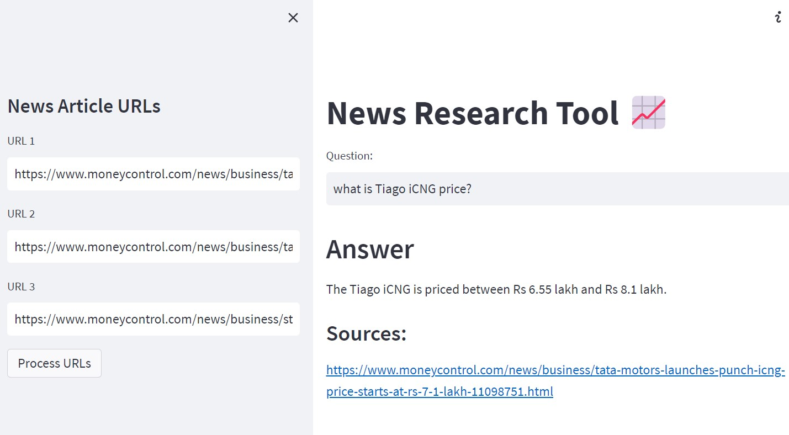
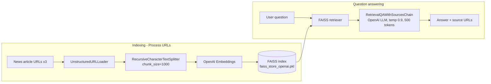

# RAG-Powered Financial News Research Assistant

A Streamlit research tool for **equity and financial-news analysis**. Paste up to three article URLs, and the app scrapes them, builds a **FAISS** vector index with **OpenAI embeddings**, and answers your questions with a **source-cited** answer — so you can see exactly which article each claim came from.



---

## Features

- **URL ingestion** — loads full article content from up to 3 news URLs with LangChain's `UnstructuredURLLoader`.
- **Structure-aware chunking** — `RecursiveCharacterTextSplitter` (1,000-char chunks) splits on paragraphs → lines → sentences → clauses (`\n\n`, `\n`, `.`, `,`), keeping related sentences together.
- **Semantic index** — chunks embedded with OpenAI embeddings and stored in a **FAISS** index, persisted to disk so you can keep asking questions without re-processing.
- **Answers with citations** — LangChain `RetrievalQAWithSourcesChain` retrieves the most relevant chunks and returns `{answer, sources}`; sources are listed under every answer.
- **Simple UI** — Streamlit sidebar for URLs, live progress messages (loading → splitting → embedding), and a question box.

---

## Architecture



---

## Project structure

```
RAG-Powered-Financial-News-Research-Assistant/
├── main.py                 # Streamlit app: ingestion, indexing and Q&A
├── requirements.txt        # pinned dependencies
├── faiss_store_openai.pkl  # sample persisted FAISS index
├── rockybot.jpg            # screenshot
└── .env                    # OPENAI_API_KEY (not for real keys — see Security)
```

---

## Tech stack

| Concern | Tool |
|---|---|
| UI | Streamlit |
| Orchestration | LangChain (`UnstructuredURLLoader`, `RecursiveCharacterTextSplitter`, `RetrievalQAWithSourcesChain`) |
| Embeddings & LLM | OpenAI |
| Vector store | FAISS (CPU) |
| Config | python-dotenv |

---

## Getting started

```bash
git clone https://github.com/Amg1703/RAG-Powered-Financial-News-Research-Assistant.git
cd RAG-Powered-Financial-News-Research-Assistant
python -m venv .venv && source .venv/bin/activate   # Windows: .venv\Scripts\activate
pip install -r requirements.txt
```

Create `.env`:

```env
OPENAI_API_KEY=sk-...
```

Run:

```bash
streamlit run main.py
```

1. Paste up to three article URLs in the sidebar (e.g. stock-market news).
2. Click **Process URLs** and wait for the index to build.
3. Ask a question, e.g. *“What was the company's quarterly revenue?”* — the answer appears with its source URLs.

---

## Notes & limitations

- Dependencies are pinned to the 2023 LangChain (`0.0.284`) and OpenAI (`0.28`) APIs. Newer versions moved these imports to `langchain-community` / `langchain-openai`; migrating is on the roadmap.
- The FAISS index is pickled to disk. Only load pickles you created yourself.
- **Security:** never commit a real API key. Keep `.env` in `.gitignore` and rotate any key that has been pushed.

## Roadmap

- [ ] Migrate to current LangChain packages and OpenAI chat models
- [ ] Use `FAISS.save_local` / `load_local` instead of pickle
- [ ] Support any number of URLs and PDF uploads
- [ ] Lower temperature for factual Q&A; stream answers
- [ ] Hybrid (BM25 + vector) retrieval and re-ranking

---

## Acknowledgements

Built while following the [Codebasics](https://codebasics.io) LangChain project series (“News Research Tool”), then extended and documented here.

## Author

**Arjun Mageswaran** — AI/LLM Engineer · [GitHub](https://github.com/Amg1703) · [LinkedIn](https://www.linkedin.com/in/arjun-mageswaran-a5b694362)
